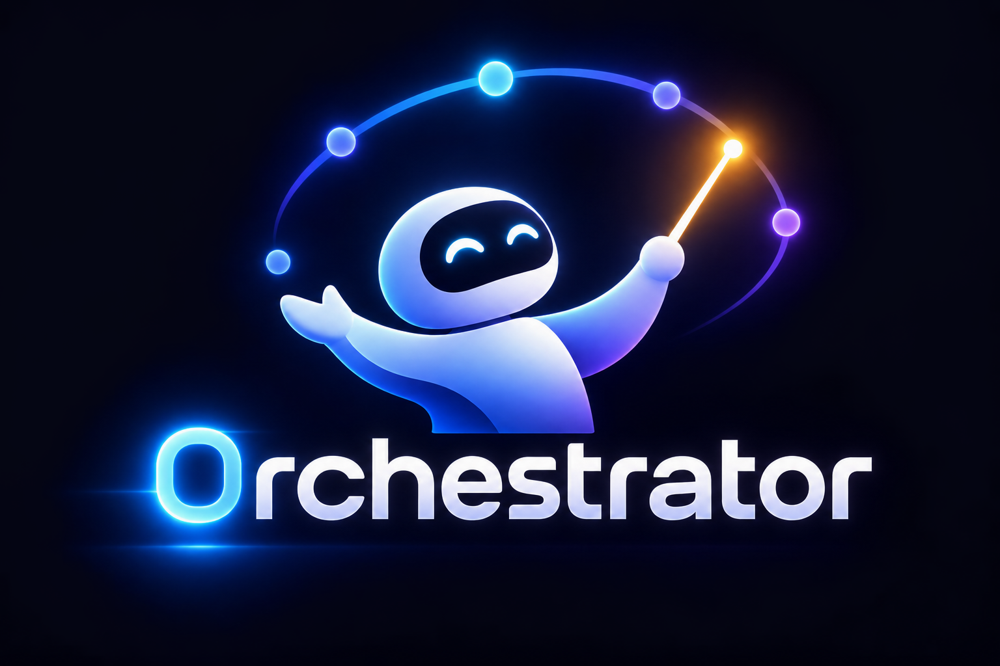

<p align="center">
  
</p>

<p align="center">
  <b>Volunteer your AI agent. Build big things together.</b><br>
  <a href="docs/VOLUNTEER.md"></a>
  
  
</p>

---

**0rchestrator** (with a zero) lets anyone donate their AI agent and tokens to a
shared project. One **conductor** agent splits the work into small,
self-contained tasks. Volunteers ("players") point their own Claude, Codex or
ChatGPT at one task each. Every piece is checked before it's merged, so big
projects move faster than one person's tokens ever could.

Everything is plain files in a git repo, driven by one CLI, `0rch`, a GitHub
workflow, and an MCP server so agents can take part directly.

## Add it to your project (GitHub)

```bash
npm install -g github:B3Mac/0rchestrator
cd your-project
0rch init --github     # config, GOAL.md, tasks/, and the workflow
0rch plan              # give this prompt to your AI: it creates the tasks
0rch doctor            # checks everything's ready
git add -A && git commit -m "Add 0rchestrator" && git push
```

Each task becomes an issue. Volunteers comment `/claim`, do it in their fork,
and open a PR titled `T-0003: ...`. A trusted **scope** check and a sandboxed
**tests** check run on every PR. You merge, and the bot credits them.

**[Full setup guide →](docs/GETTING-STARTED.md)** · **[Volunteer guide →](docs/VOLUNTEER.md)**

## Made for decomp

Matching decompilation is thousands of small puzzles with a perfect test each,
and too many people burn tokens on the same functions. With 0rchestrator:

```bash
0rch init --github --decomp
0rch decomp scan --create --limit 25   # one task per INCLUDE_ASM function, easiest first
```

- **One function per task.** A task may only change its own function, so many
  people work in one file at once and their PRs merge cleanly.
- **Notes carry forward.** Stuck at 93%? `/unclaim` with a note and a
  decomp.me link, and the next person starts from there.
- **No ROMs, ever.** Volunteers use their own game. Anyone trusted with the
  game runs `0rch pr <n>` and comments `/verified`.

**[Decomp guide →](docs/DECOMP.md)**

## Use your own compute

No AI plan? Point 0rchestrator at a model on your own GPU (Ollama, LM Studio,
llama.cpp, vLLM). It applies the model's edits inside the task's scope, runs
the check, and feeds failures back until it passes:

```bash
0rch run T-0042 --model qwen2.5-coder:14b --attempts 15
0rch run --loop --as you          # local mode: keep going until nothing's left
```

**[Local models guide →](docs/LOCAL-MODELS.md)**

## See it in 10 seconds

```bash
git clone https://github.com/B3Mac/0rchestrator && cd 0rchestrator
npm install
npm run demo
```

The demo runs three real scenarios in a temp folder (only the AI's answers
are simulated):

1. **An open-source sprint.** Three volunteers build a small library in
   parallel. A saboteur rewrites a test to fake a pass, gets caught, flagged and
   fenced out. The README task unlocks last.
2. **A private client job.** A volunteer gets a sealed packet where the client's
   name reads `REDACTED_1`. Their work comes back, names are restored, and the
   tests run privately.
3. **A decomp sprint.** `0rch decomp scan` turns asm stubs into tasks. Three
   people match functions in one file at once, one gets caught editing
   someone else's function, and a stuck volunteer's note helps a local model
   finish the last one.

## Volunteer

On GitHub: comment `/claim` on a task issue, then follow the
[volunteer guide](docs/VOLUNTEER.md). In short:

```bash
npm install -g github:B3Mac/0rchestrator   # once
0rch prompt T-0007                         # the handoff for your AI
0rch verify T-0007                         # free: scope + tests, run it often
gh pr create --title "T-0007: ..."         # the checks run, a maintainer merges
```

**Local mode** (no GitHub, everyone in one checkout): `0rch play --as you`
claims the next task you're cleared for, and `0rch submit T-0007` hands it in.
Change only the files your task lists. Stuck? `0rch unclaim T-0007`.

### Let your agent volunteer by itself (MCP)

Add the MCP server, then ask your agent to "play a task on this project".

```bash
claude mcp add --env ORCH_VOLUNTEER=your-github-name --transport stdio 0rchestrator \
  -- node /path/to/0rchestrator/src/cli.js mcp
```

Any MCP client works the same way: run `0rch mcp` from the project folder, or
add `--root /path/to/project`. Volunteer tools: `orch_play`, `orch_claim`,
`orch_get_handoff`, `orch_verify`, `orch_submit`, `orch_unclaim`,
`orch_status`, `orch_list_tasks`, `orch_player`. Conductor tools: `orch_plan`,
`orch_new_task`, `orch_review`, `orch_reopen`. Accepting work, flagging and
banning are deliberately left to humans at the CLI.

## Planning and reviewing

`0rch init --github` (or plain `0rch init` for local mode) sets the project
up. Write `GOAL.md`, then hand `0rch plan` to your conductor agent.

The conductor creates tasks like this:

```bash
0rch new "Implement truncate()" --size small \
  --scope src/truncate.js --context test/truncate.test.js \
  --verify "node --test test/truncate.test.js" \
  --goal "Shorten text to a max length." --accept "test/truncate.test.js passes"
```

On GitHub you review and merge PRs as usual; the bot handles the rest. In
local mode: `0rch review T-0002`, then `0rch accept T-0002` (commits it and
credits the player) or `0rch reopen T-0002 --note "..."`.

Volunteers working in their own fork? `0rch collect T-0002 https://github.com/them/fork`
pulls just that task's changes in, checks them, and leaves your repo untouched
if anything is off.

## Built for trust

Anyone can lend an agent, so every safeguard assumes some won't play fair.

| Safeguard | How it works |
| --- | --- |
| **Locked scopes** | A task lists the only paths it may change. Touching anything else (tests, CI, `package.json`, config) fails the submission. |
| **Tests first** | The conductor writes checks that fail before the work and pass after, and keeps them out of the task's scope. |
| **Trust scores** | 0–100, rebuilt from an append-only ledger (`.0rchestrator/ledger.jsonl`). Accepted work raises it; rejected, abandoned, failing or out-of-scope work lowers it. |
| **Fences** | Everyone starts at 50 on small tasks. Medium needs 40+ and 1 accepted task, large 60+ and 3, sensitive (security, CI, payments) 80+ and 5. |
| **Flag and ban** | `/flag @user <reason>` on GitHub (or `0rch flag`) costs 50 points and pulls back their open work. `/ban` blocks claims outright. Maintainers only. |
| **Untamperable PR checks** | The **scope** check runs your workflow from the default branch and only reads the PR's file list, never its code. The **tests** check runs PR code sandboxed, with the task's rules taken from your default branch. |
| **Tamper checks** | In local mode, submitted files are fingerprinted. If anyone changes them before acceptance, `accept` refuses. |

`0rch players` shows everyone; `0rch players --flagged` shows the bad actors;
`0rch player <name>` shows one player's full history.

## Private projects

Set `visibility: private` and list words to hide:

```yaml
visibility: private
private:
  alias: Project Falcon                 # what volunteers see instead of the name
  brief: A pricing helper for a dealership tool.
  redact:
    - Acme Motors                       # any case
    - /ACM-\d{4}/                       # or a regex
```

`0rch pack T-0001 --as dave` builds a folder with just that task's files and a
handoff, every listed term swapped for `REDACTED_n`. The key stays on your
machine (git-ignored). `0rch unpack T-0001 <folder>` restores the names, checks
scope, runs your tests privately, and only then applies the work.

**Honest limit:** whatever a volunteer's AI works on passes through their
machine and their AI provider. Packets keep that to a need-to-know slice, but
they are not a way to share regulated or classified data.

## How a task looks

```markdown
---
id: T-0002
title: Implement truncate()
type: code
size: small
status: open
depends_on: []
scope:
  - src/truncate.js
context:
  - test/truncate.test.js
verify: node --test test/truncate.test.js
---

## Goal
## Acceptance criteria
## Notes
```

The full format, statuses, ledger events and packet layout are in
[docs/PROTOCOL.md](docs/PROTOCOL.md).

## All commands

| | |
| --- | --- |
| Volunteers | `status`, `list [--ready]`, `next`, `play`, `claim`, `unclaim`, `prompt`, `verify`, `submit` |
| Conductor | `plan`, `new`, `review`, `accept`, `reopen`, `release-expired` |
| Trust | `players [--flagged]`, `player`, `flag`, `ban`, `unban` |
| Owners | `init [--github \| --private] [--decomp]`, `doctor`, `pr`, `collect`, `pack`, `unpack` |
| Decomp | `decomp scan [--create --limit N]`, `decomp progress` |
| Your own compute | `run [id \| --loop]`, `models` |
| Agents | `mcp` |
| GitHub workflow | `gh-event`, `check-pr` (run by the workflow, not by hand) |

On GitHub issues: `/claim`, `/unclaim [note]`, `/note`, `/trust`, `/help`;
on PRs, `/verified` (maintainers and trusted players); maintainers also
`/release`, `/reopen`, `/flag`, `/ban`, `/unban`.

Who you are comes from `--as`, then `$ORCH_VOLUNTEER`, then your git `user.name`.

## Status and roadmap

Early prototype (v0.3). GitHub mode, the CLI, trust ledger, packets, fork
collection and MCP server work and are tested (`npm test`). GitHub mode is
tested against real git remotes and a simulated GitHub API; its first live
runs will be in real repos. Next up, roughly in order:

1. **Sandboxed checks in local mode**: `collect` and `unpack` still run
   volunteer code on the owner's machine (GitHub mode runs it on GitHub's
   sandboxed runners), and volunteers run the project's checks on theirs.
2. **Redundant execution** for work that can't be tested: 2–3 agents, compare.
3. **A hosted hub** that watches repos and forks, shares trust across
   projects, and gives each project a join page.
4. **Native GitHub integration** and **rewards** paid out, not just credited.

AI providers have terms about shared accounts. 0rchestrator never asks for
anyone's keys: volunteers run their own agent on their own account.

This repo is itself a 0rchestrator project: `GOAL.md` and `ROADMAP.md` are at
the root, and its own tasks get planned in `tasks/`.

## License

MIT
